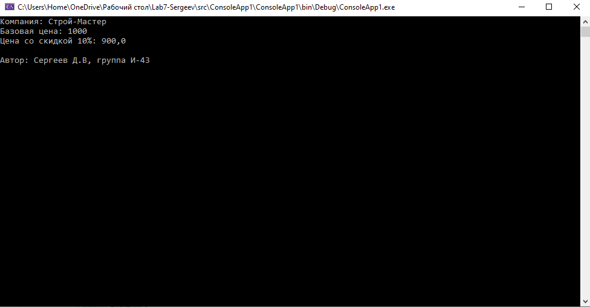
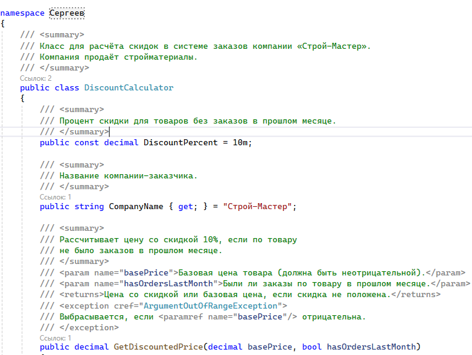
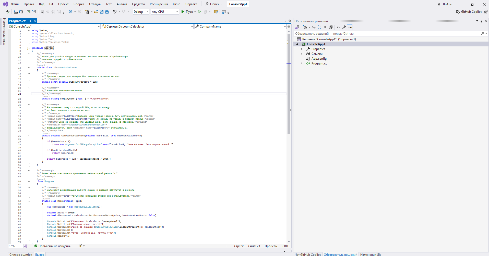

# Система заказов компании «Строй-Мастер»

**Автор:** Сергеев., группа И-43
**Вариант:** 14 — Строй-Мастер (стройматериалы)

## Что делает программа
- Рассчитывает цену со скидкой 10% для товаров, по которым не было заказов в прошлом месяце
- Если заказы были — возвращает базовую цену без скидки
- Выводит базовую цену, цену со скидкой и данные автора в консоль
- Демонстрирует работу метода `GetDiscountedPrice`

## Правило скидки (вариант 14)
> Нет заказов в прошлом месяце → скидка **10%**.

## Как запустить
1. Открыть файл `src/Lab7.sln` в SharpDevelop или Visual Studio
2. Нажать **F5**
3. В консоли появится результат расчёта и данные автора

## Скриншоты

### Скриншот 1: Результат работы программы

### Скриншот 2: XML-комментарии в коде

### Скриншот 3: Среда разработки
